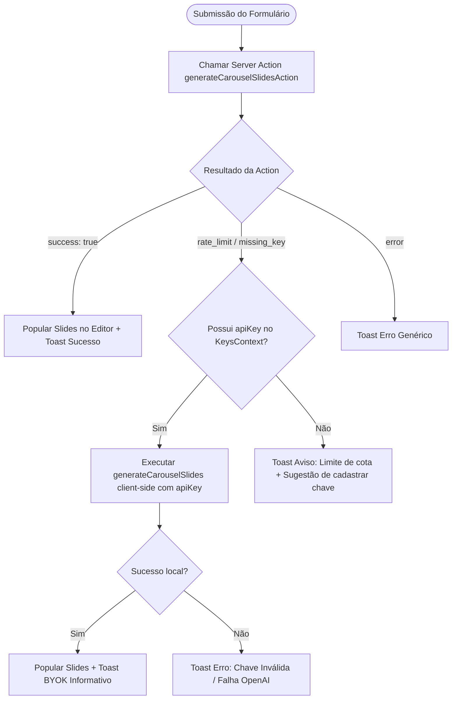

# Contrato de Interface: Fallback Client-side BYOK

> Feature: `002-byok-fallback`  
> Localização: `carousel-generator-main/src/lib/langchain.ts`  

## 1. Assinatura do Cliente Local

```ts
export async function generateCarouselSlides(
  topicPrompt: string,
  apiKey: string
): Promise<z.infer<typeof MultiSlideSchema> | null>
```

## 2. Fluxo de Decisão no Cliente


